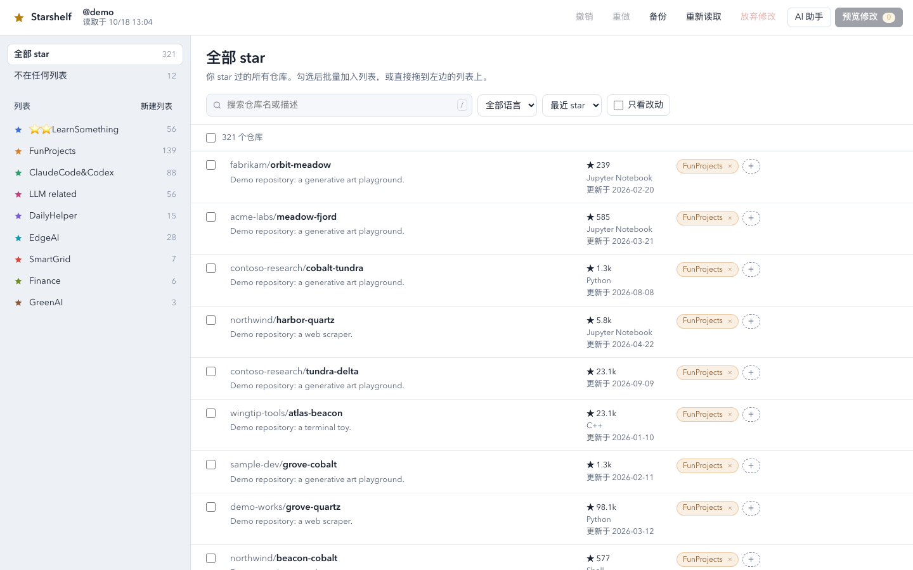
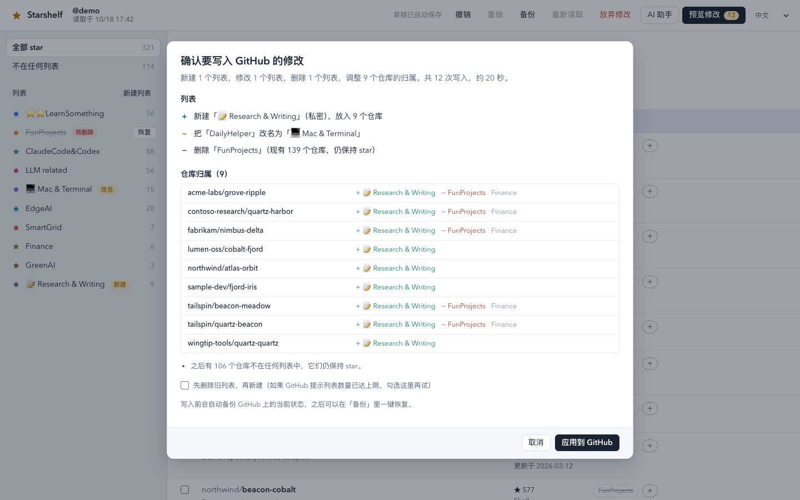
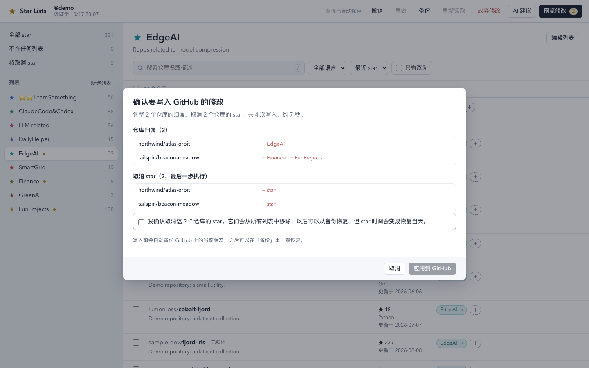
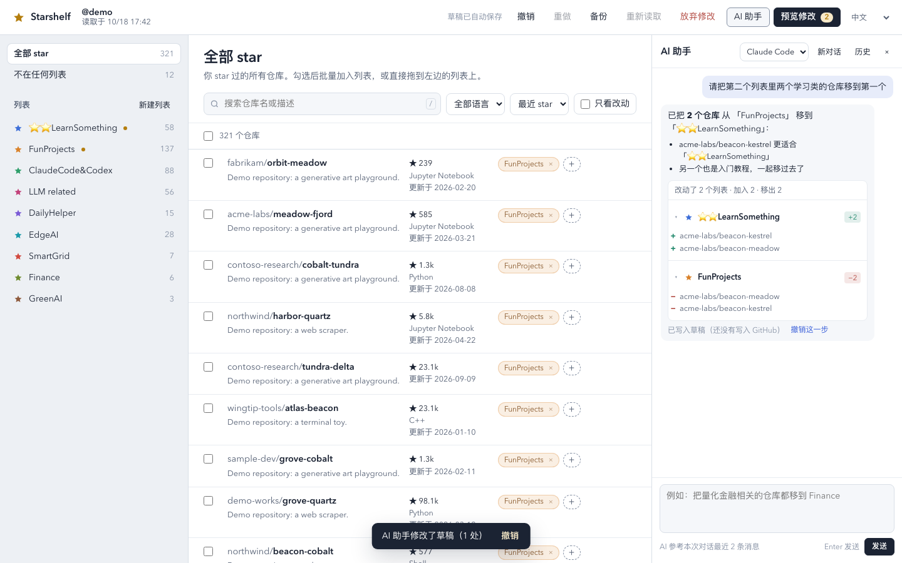

# starshelf

**English** · [简体中文](README.zh-CN.md)

Organise your **GitHub Star Lists** in bulk. GitHub's web page changes one repository at a time;
starshelf lets you create, rename and delete lists, and add, move or remove hundreds of starred
repositories at once — in a local web page, a small macOS app, or from the command line.



## What it does

- **Edit a draft, then apply.** Every change is a local draft (saved automatically, with undo/redo).
  Nothing reaches GitHub until you open the preview and press *Apply to GitHub*.
- **Preview first.** The preview lists every list that is created, renamed or deleted and every
  repository whose lists change.
- **Backup before every write.** Each apply first saves the current state; any backup can be
  restored from the *Backups* dialog (or `star_lists.py restore`).
- **Safe and resumable.** If GitHub fails half-way (network, rate limit), apply again: it continues
  from the live state. After writing, starshelf reads GitHub back and checks the result.
- **Never unstars by accident.** Only repositories you explicitly mark *Unstar* lose their star:
  they are listed separately in the preview, you must tick a confirmation box, and the star is
  removed as the very last step. A later restore stars them again (with a new star date).
- **Optional AI assistant.** Chat with an AI in a side panel ("move the quant repos to Finance",
  "split FunProjects into three lists") — each answer edits the draft as one undoable step. AI only
  ever changes the draft. It runs through your
  local **Claude Code** or **Codex** CLI and uses that tool's own subscription — no API key, no extra bill.



## Requirements

- Python 3.9 or newer.
- A GitHub token with the `user` scope. Easiest: the [GitHub CLI](https://cli.github.com/), logged in
  (`gh auth login`), then `gh auth refresh -h github.com -s user`. Or set `GH_TOKEN`.
- `pip install pyyaml` — only for the command-line `layout.yaml` workflow.
- Optional, for the AI features: the `claude` (Claude Code) or `codex` CLI, logged in with your subscription.

## Quick start

```bash
git clone https://github.com/dtjgp/starshelf.git
cd starshelf
python3 star_lists_ui.py          # opens http://127.0.0.1:8765/#t=<per-run secret> in your browser
```

Your data (backups, draft, logs) is kept in `stars_backup/` next to the scripts. Use `--dir` to
choose another folder.

### macOS app

```bash
cd app && ./build_app.sh --install    # needs Xcode Command Line Tools; installs "Starshelf.app"
```

The app is a small window around the same local page. It keeps its data in
`~/Library/Application Support/Starshelf`; to use another folder:

```bash
defaults write io.github.dtjgp.starshelf SLDataDir "~/path/to/folder"
```

On macOS 26 and later the icon follows **System Settings → Appearance → Icon & widget style**
(Default, Dark, Clear, Tinted) when the app is built with Xcode 26 or later; older macOS shows the
classic icon. The build is ad-hoc signed for your own Mac. A copy downloaded from elsewhere would be blocked
by Gatekeeper, so build it yourself.

### Command line

```bash
python3 star_lists.py export     # backup + an editable stars_backup/layout.yaml
# edit layout.yaml: move repo lines between lists, rename/delete/add list blocks,
# cut repo lines into `unstar:` to remove their star
python3 star_lists.py plan       # dry run
python3 star_lists.py apply      # asks, backs up, applies, verifies
python3 star_lists.py restore stars_backup/snapshots/<file>.json
```

With `--yes`, a plan that removes stars also needs `--allow-unstar`.



## AI assistant

**AI 助手** (AI assistant) opens a chat panel on the right. Tell it what to change in plain words —
from a single move to a complete new layout. It asks back when a request is unclear.

- Each answer is a short note (with **bold** and bullet lists where useful) plus **change cards**:
  one row per list with `+N` / `−N` tags, new / renamed / deleted lists and the unstar marks; open a
  row to see which repositories moved, click the list name to jump to it.
- Every answer is one step in your draft: undo it from the message or with the normal undo.
- **新对话** (new conversation) starts a new topic: earlier messages stay visible but are no longer sent
  to the AI. A note under the input says how many recent messages the AI is using.
- After you apply to GitHub or reread it, the conversation is archived. **历史** (history) lists the last
  10 conversations with their changes, read-only; they stay in this browser only and can be cleared.
- Drag the panel's left edge to make it wider or narrower (or focus the edge and use ← / →;
  double-click resets it). The width is remembered.



Pick the backend in the panel:

| Backend | Uses | Notes |
|---|---|---|
| Claude Code (default) | `claude -p`, your Claude Code login | Runs with no tools, no MCP servers and no user settings. |
| Codex | `codex exec`, your Codex/ChatGPT login | Read-only sandbox in an empty folder, but its tools cannot be fully switched off; the page shows a warning. |

Models can be changed with `STAR_LISTS_CLAUDE_MODEL` and `STAR_LISTS_CODEX_MODEL`. Each run counts
against that tool's subscription usage limits; Starshelf removes API-key variables from the CLI's
environment so the subscription login is used.

## Privacy and security

- The page is served on `127.0.0.1` only; every API call needs a per-run secret, and the Host and
  Origin headers are checked. Your GitHub token stays in the local Python process.
- Data leaves your computer only to GitHub — and, if you use the AI assistant, the repositories'
  names, languages and descriptions plus your list names go to the AI service you chose
  (Anthropic or OpenAI). The GitHub token is never sent to an AI service.

## Tests

All tests use an in-memory fake of GitHub — no network, no token.

```bash
pip install pyyaml playwright && python3 -m playwright install chromium
python3 tests/test_engine.py
python3 tests/test_lifecycle.py
python3 tests/test_ai.py
python3 tests/test_ui.py          # browser click-through on a made-up account
```

## Limitations

- GitHub Lists are still a public preview; the API may change.
- GitHub limits write speed: starshelf waits about 1 s between writes, so hundreds of changes take
  minutes.
- Tested on macOS. The page and the command line should also work on Linux; Windows is untested.

## License

[MIT](LICENSE)
